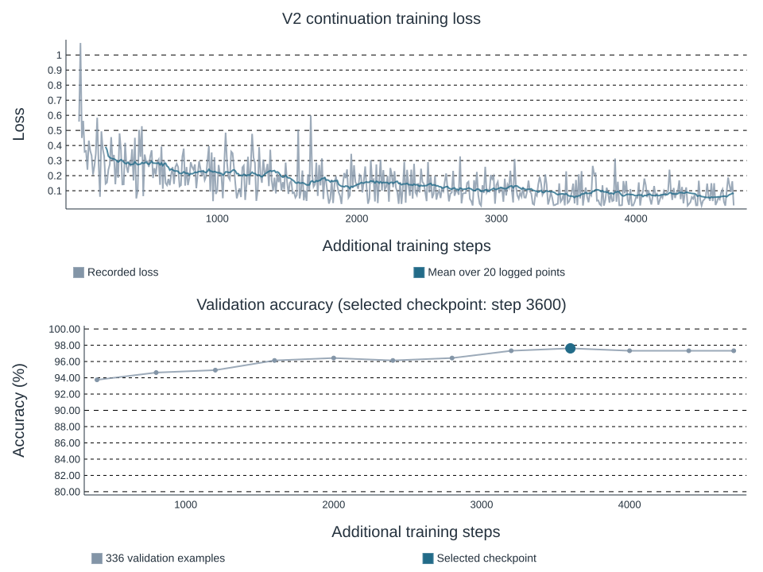
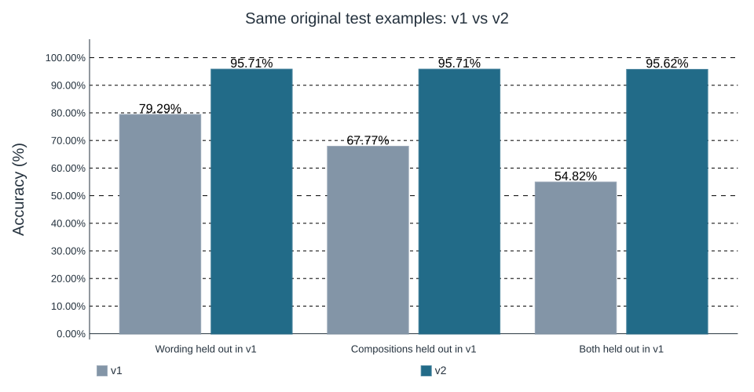

# 사진 여섯 장과 자연어 조건으로 decision model 학습하기

Tiny ImageNet 사진과 자연어 지시로 작은 선택 문제를 구성하고, Qwen3.5-4B 기반 decision model을 학습한 기록이다. v1에서 드러난 표현·조건 조합의 약점을 v2의 데이터 구성으로 보완하였다. 이 글에서는 데이터가 무엇을 의미하는지부터 학습 대상, 실제 개선 폭, 실패 사례와 재현 방법까지 살펴본다. [코드와 가중치](https://github.com/gisbi-kim/tiny-visual-reasoning-lab), [실험 자료 안내](v2/INDEX.md)를 함께 공개한다.

## 1. 풀고 싶은 문제

사진을 분류하는 모델은 보통 한 장의 사진을 입력받아 고양이, 바나나 등의 이름을 출력한다. 이번에는 사진을 여섯 장 놓고, 자연어로 주어진 조건에 맞는 위치를 고르게 하였다. 예를 들어 다음과 같은 사진판을 생각해 보자.

| | 왼쪽 | 가운데 | 오른쪽 |
|---|---|---|---|
| 윗줄 | A: 개 | B: 바나나 | C: 고양이 |
| 아랫줄 | D: 구명보트 | E: 금붕어 | F: 배낭 |

“고양이 사진을 골라”의 답은 C이다. “고양이에서 왼쪽으로 한 칸, 그다음 아래로 한 칸 이동해”라고 하면 C → B → E 순서로 따라가야 한다. “동물 사진이 세 장 이상이면 바나나를, 아니면 배낭을 골라”의 답은 B이다. 개, 고양이, 금붕어가 동물에 해당하기 때문이다.

이때 세는 것은 **동물이 나온 사진의 수**이다. 한 사진에 여러 동물이 있더라도 중심 대상 하나로 표현한다. 격자 밖으로 이동하거나 조건에 맞는 사진이 없으면 NONE을 선택한다. 출력 공간은 A, B, C, D, E, F, NONE의 일곱 가지이다.

## 2. 기본 모델과 우리가 학습하는 부분

기반 모델은 Qwen3.5-4B이다. 이 모델은 이미지와 텍스트를 함께 처리할 수 있다. 여기에 LoRA와 Clef 방식의 선택용 head를 붙였다. 입력 사진과 자연어 지시에서 표현을 계산한 뒤, 선택용 head가 각 선택지의 점수를 내는 구조이다.

여기서 Clef는 head의 구조와 입력 형식을 뜻한다. Cloudflare가 배포한 완성형 Clef 모델의 가중치를 가져온 실험은 아니다. v1은 Qwen의 사전학습 가중치에 새 LoRA와 head를 붙여 학습했고, v2는 그 학습 결과를 이어받았다. [실제 모델 생성 코드](../train.py)와 [배포 추론 코드](../engine.py)를 공개한다.

Head는 단순한 7출력 선형층보다 복잡하다. 입력 hidden size는 2,560, head 내부 폭은 512이고, routing 2층·decoder 4층·attention head 8개·feed-forward 폭 2,048을 사용한다. 입력 sequence의 hidden states와 질문·선택지 span을 이용해 선택지별 점수를 만든다. 선택지 span은 입력의 token 위치이며 정답 위치를 의미하지 않는다. [Head 참조 구현](../clef_reference.py)에서 구체적인 연산을 확인할 수 있다.

```text
2×3 사진 격자 + 자연어 지시 + 선택지 정의
                 ↓
       Qwen3.5-4B + 학습한 LoRA
                 ↓
          학습한 Clef head
                 ↓
         A B C D E F NONE 점수
```

앱에서 Qwen이 자유로운 설명문을 생성하는 것은 아니다. 또한 정답을 만드는 규칙 프로그램을 앱에 넣어 대신 계산하게 하지 않았다. 규칙 프로그램은 학습 데이터의 정답을 만들고 검사하는 데 사용한다. 실제 예측 경로에는 사진과 사용자가 입력한 문장만 들어간다.

학습은 정답 선택지를 알려 주는 지도학습이다. 일곱 점수에 softmax를 적용한 확률을 p라고 하면, 정답 a*에 대한 loss는 −log p(a*)이다. 틀린 선택에 높은 확률을 줄수록 손실이 커지고, 그 gradient로 LoRA와 head를 갱신한다. 사람이 작성한 단계별 사고 과정을 생성하도록 학습한 것은 아니다.

LoRA는 사전학습 가중치 W를 고정한 상태에서 작은 행렬 A, B를 학습하여 W + (alpha/r)BA 형태로 가중치의 변화를 표현한다. 이번에는 rank와 alpha를 모두 16으로 두었다. LoRA 32,464,896개와 선택용 head 32,046,596개를 학습하여 합계 64,511,492개가 학습 대상이다. 기본 모델·LoRA·head를 포함한 논리 파라미터 4,603,777,028개 중 약 1.40%에 해당한다.

4bit 양자화는 저장과 연산에 필요한 메모리를 줄이는 방법이다. 4bit로 저장했다고 파라미터의 개수 자체가 줄어드는 것은 아니므로, 학습 비율의 분모는 압축된 텐서의 저장 원소 수와 구분하였다.

## 3. 사진보다 먼저 정해야 하는 의미

원본은 Tiny ImageNet이다. 200개 클래스 중 작은 사진에서도 대상이 비교적 분명한 40개 클래스를 사용하였다. 원본 bounding box로 중심 대상을 잘라 비율을 유지한 채 격자에 배치하고, 너무 작은 대상과 RGB가 완전히 같은 중복 사진을 제외하였다. 원본 해상도는 64×64이므로 확대하더라도 실제 세부 정보가 새로 생기는 것은 아니다.

사진마다 어떤 범주에 속하는지 명시적인 표를 만들었다. 예를 들어 금붕어는 물고기이면서 동물이다. 곰 인형은 동물 사진으로 세지 않는다. 이 정의가 불명확하면 “동물이 몇 장인가”라는 문장에 대해 정답부터 일관되지 않게 된다.

클래스 표본과 문장 틀은 코딩 에이전트가 검토하였다. 모든 사진을 사람이 독립적으로 검수한 데이터는 아니다. 가려진 물체나 배경에 있는 다른 물체 때문에 실제 이미지의 의미가 모호할 수 있다는 한계는 남는다.

## 4. 자연어와 정답을 함께 만드는 방법

먼저 문장과 독립적인 의미 프로그램을 만든다. 예를 들어 앞의 C → B → E 문제는 다음과 같이 쓸 수 있다.

```json
{"family":"chain","anchor":"cat","direction":"left","second_direction":"down"}
```

사진판의 대상 목록에 이 프로그램을 실행하여 정답을 구하고, 같은 프로그램을 여러 문장으로 표현한다. 문장을 만드는 함수에는 정답을 전달하지 않는다. 방향이나 대상을 바꿨을 때 정답이 달라지는 문제 쌍도 함께 만든다. 같은 사진판이라도 지시를 제대로 읽어야 답할 수 있도록 하기 위해서이다.

v2에서는 12개 조건 유형에 대해 한국어·영어 각각 6개의 문장 틀을 사용한다. 총 144개의 틀에 대상 이름, 범주, 요청 표현을 조합한다. “3장/세 장”, “3/three”, “왼쪽/좌측”과 같은 표기도 섞었다. 이 수치는 세상의 모든 자연어 표현을 다루었다는 뜻은 아니다. 범위를 정하고 그 범위 안의 표현을 고르게 공급한 합성 데이터이다.

원본 사진 12,830장으로 격자 4,825장을 만들고, 여기에 지시와 정답을 붙여 37,632개의 학습 예제를 만들었다. 서로 다른 문장은 36,328개이다. 한 격자에 여러 지시를 붙이므로 원본 사진 수, 격자 수, 학습 예제 수는 서로 다르다.

## 5. v1에서 v2로 바꾼 이유

v1에서는 일부 문장 틀과 두 조건 조합을 학습에서 제외하였다. 가령 “고양이 왼쪽 사진”을 학습한 뒤 “고를 사진 오른쪽에 고양이가 있어야 한다”는 표현도 이해하는지 확인하려는 목적이었다. 같은 행에서 범주를 찾은 다음 한 칸 이동하는 조건도 별도로 보류하였다.

두 버전의 데이터 크기도 함께 보자. v2는 단순히 같은 예제를 한 번 더 반복한 실행이 아니라, 사용할 표현과 조건의 범위를 넓혀 새로 구성한 데이터로 이어서 학습한 실행이다.

| 학습 데이터 | v1 | v2 |
|---|---:|---:|
| 원본 사진 | 12,023장 | 12,830장 |
| 2×3 사진판 | 4,024개 | 4,825개 |
| 지시·정답 예제 | 31,360개 | 37,632개 |
| 서로 다른 문장 | 29,350개 | 36,328개 |

사진 수는 각 버전 안의 고유 개수이다. 같은 학습 사진 풀을 사용하므로 두 열을 더해 전체 고유 사진 수로 삼으면 안 된다. [v1 집계](data-summary.json), [v2 집계](v2-data-summary.json)에 세부 구성을 남겼다.

이 설계는 배운 내용을 새로운 표현과 조합에 적용하는 능력을 조사할 때 유용하다. 반면 사용자가 실제로 입력할 것으로 예상하는 표현까지 제외할 필요는 없다. v2에서는 지원할 12개 조건과 144개 표현을 모두 학습하는 방향으로 바꾸었다.

여기서 표현의 분할과 사진의 분할을 구분해야 한다. 표현을 모두 학습시키더라도 평가 사진까지 학습에 넣을 이유는 없다. 원본 사진 ID와 전체 RGB hash를 기준으로 학습·검증·보정·평가를 분리하였다. v1 평가 사진은 v2 학습에 들어가지 않는다.

## 6. 한 에폭의 의미와 실제 학습

이번 v2는 사전학습 모델에서 곧바로 시작한 첫 학습이 아니다. v1에서 검증으로 선택한 step 2,400의 LoRA와 head에서 이어서 학습한다. 계획한 추가 학습량은 37,632개 예제, batch 8, 4,704 step으로 1 epoch이다.

한 epoch는 각 예제를 한 번씩 사용하는 단위이다. 같은 원리를 한 번만 본다는 뜻은 아니다. 조건 유형 하나당 3,136개 예제가 있으며, 서로 다른 사진과 표현에서 같은 원리를 반복하게 된다. 가중치도 한 epoch 안에서 4,704번 업데이트한다.

기반 VLM은 이미 이미지·언어에 관한 큰 규모의 학습을 거친 상태이다. 예전 ImageNet 분류 사전학습이 주로 시각 특징을 전달했다면, VLM은 이미지와 언어의 대응 및 지시 처리 능력도 가져온다. 적은 추가 학습으로 이 작업에 적응할 수 있는 이유로 생각할 수 있다. 다만 이번 실험은 그 기여를 분리해 측정한 실험이 아니며, 파인튜닝 전 순수 Qwen 대조군을 실행하지 않았다. LoRA 역시 적은 epoch로 충분하다는 보증이 아니라 파라미터 효율적인 적응 방법이다.

실제 장비는 Windows의 RTX 4070 Ti SUPER 16 GB 한 장, Ryzen 7 9800X3D, RAM 64 GB이다. NF4 4bit로 기본 모델을 읽고 BF16으로 계산한다. LoRA 학습률은 1e-4, head 학습률은 5e-5이며 cosine schedule을 사용한다.

실제 추가 학습은 148.1분 동안 진행되었다. Trainer 기록 기준이며, 사전 다운로드·데이터 생성·최종 평가 시간은 제외한다. v1의 전체 run 135.7분과 별개인 추가 시간이다. 고정 검증 336개에서 가장 높았던 step 3,600의 가중치를 배포한다. 최고 점수가 같으면 먼저 저장된 체크포인트를 유지한다.

| 항목 | 실제 기록 |
|---|---|
| 장비 | NVIDIA GeForce RTX 4070 Ti SUPER · Windows · RAM 약 64 GB |
| 추가 학습 예제 | 37,632개 |
| 추가 학습 완료 | 4,704 step · 1.00 epoch |
| Trainer 실행 시간 | 148.1분 |
| 선택한 배포 체크포인트 | v2 step 3,600 |
| 선택 시점까지 v2 예제 제시 | 28,800회 |
| 고정 검증 336개에서 선택 점수 | 97.62% |
| 최대 PyTorch 할당 / 예약 | 6.20 / 7.06 GiB |

v1의 부모 체크포인트는 step 2,400에서 선택되어 19,200회의 예제 제시를 반영했다. v2 배포 체크포인트는 거기서 28,800회를 추가로 본 상태이다. 데이터셋이 바뀌었으므로 두 단계의 epoch를 단순히 더하지 않는다. 전체 run이 1 epoch를 완료했더라도 이후 step의 업데이트가 앞서 선택된 배포 가중치에 포함되는 것은 아니다.



위 그림의 loss는 기록된 logging 간격의 값과 20개 기록의 이동평균이다. 아래 검증 곡선은 학습에 넣지 않은 검증 사진으로 계산했다. 전체 점수만 보고 새로운 조합의 개선을 추정하지 않고, 다음 절에서 실제 같은 평가 문제끼리 비교한다. [설정](v2/training-config.json), [전체 loss 기록](v2/training-history.json), [검증 추이](v2/validation-history.json), [실제 시간·메모리](v2/training-metrics.json).

## 7. 무엇이 얼마나 좋아졌는가

사용자가 궁금했던 비교는 기존의 세 평가 문제를 그대로 다시 풀렸을 때의 변화이다. 사진·문장·정답이 동일한 1,120개씩을 사용한다.

| 기존 평가 구분 | v1 | v2 최종 | 변화 |
|---|---:|---:|---:|
| 새 사진 + v1에서 보류했던 표현 | 79.29% | **95.71%** | **+16.43%p** |
| 새 사진 + v1에서 보류했던 조건 조합 | 67.77% | **95.71%** | **+27.95%p** |
| 새 사진 + v1에서 보류했던 표현·조합 | 54.82% | **95.62%** | **+40.80%p** |

v2에서는 위 표현과 조합을 학습했다. 따라서 v2의 점수는 해당 유형을 학습한 효과를 보여 준다. 여전히 보지 못한 표현이나 작업 조합에 대한 일반화 점수라고 부르면 안 된다. 사진은 새 사진으로 유지된다.



세 항목은 각각 같은 1,120개 문제를 사용하며, 전체 예측의 사진 ID·문장·정답이 일치하는지 코드로 검사하였다. [기존 문제 전후 비교 JSON](../results/v2/original-suite-comparison.json)과 [문제별 실제 예측](../results/v2/finetuned/)에서 확인할 수 있다.

별도로 모든 유형을 균형 있게 포함한 v2_test 2,016문제에서는 v1 **84.52% → v2 95.78%** 결과를 보였다. 한국어는 84.33% → 95.63%, 영어는 84.72% → 95.93%였다. 이 집계는 위의 세 항목과 다른 문제 집합이다. 서로 다른 표의 전후 점수를 섞어서 개선 폭을 계산하지 않는다. [동일 2,016문제 비교](../results/v2/comparison.json).

중간에는 고정 표본 56개씩을 CPU로 평가한다. 표본 점수는 방향을 살펴보는 자료이며 전체 1,120개의 결과를 대신하지 않는다. 중간 결과를 보고 학습 설정이나 체크포인트 선택 기준을 바꾸지 않는다. 최종 비교는 저장한 가중치를 별도 프로세스에서 다시 읽어 양쪽 모두 같은 CUDA 배포 코드로 수행한다.

## 8. 전체 정확도만으로 알 수 없는 것

대상 찾기, 두 단계 이동, 개수 분기, 범주별 개수 비교는 서로 다른 어려움이 있다. 아래 표는 별도 v2_test 2,016문제에서 계산한 조건별 결과이다. 조건마다 168문제이며, 위의 기존 세 항목 표와 구분한다.

| 조건 유형 | v1 | v2 |
|---|---:|---:|
| 같은 행에서 제외 | 85.71% | 97.02% |
| 이동한 칸의 행에서 범주 찾기 | 90.48% | 97.02% |
| 이동한 칸의 열에서 범주 찾기 | 93.45% | 99.40% |
| 두 단계 이동 | 88.10% | 99.40% |
| 대상 찾기 | 89.29% | 91.07% |
| 같은 열의 범주 | 94.05% | 98.81% |
| 개수 기준 분기 | 79.17% | 88.69% |
| 인접 위치와 범주 | 85.12% | 99.40% |
| 인접 위치 | 87.50% | 97.62% |
| 같은 행의 범주를 찾은 뒤 이동 | 44.64% | 95.83% |
| 범주별 개수 비교 | 82.74% | 88.10% |
| 같은 행의 범주 | 94.05% | 97.02% |

다음은 기존 세 평가 항목에서 순서상 처음 나온 v2 오답이다. 결과를 좋게 보이게 할 목적으로 실패 유형을 골라내지 않았다. 각 문장의 사진판과 정답 정의는 위에서 연결한 전체 예측 파일의 source IDs와 프로그램으로 추적할 수 있다.

- `test_language`: “부탁 하나 할게. 고를 사진은 먹거리 사진이면서 이집트고양이 사진과 행이 같아야 해. 해당하는 사진이 없으면 NONE이야.” → 정답 **A**, 예측 **NONE**. 사진판 ID `test_language-00106`.
- `test_composition`: “First find ladybug, then step one tile to the left. Which fish photo shares that column? Choose NONE if no tile qualifies.” → 정답 **NONE**, 예측 **A**. 사진판 ID `test_composition-00003`.
- `test_combined`: “부탁 하나 할게. 포유류 사진을 고르되, 고양이에서 오른쪽 한 칸 이동해서 도착한 열 안에서 찾아야 해. 해당하는 사진이 없으면 NONE이야.” → 정답 **NONE**, 예측 **C**. 사진판 ID `test_combined-00001`.

고정 사진판의 같은 구어체 14개에서는 **v1 12/14 → v2 11/14** 결과를 보였다. 이 시연에서는 오히려 한 문제를 덜 맞혔다. 하나의 사진판에서 이미 작성해 둔 작은 시연이므로 일반적인 성능 하락을 추정할 근거는 부족하지만, 작성한 표현 틀의 개선을 자유로운 말투 전체의 개선으로 확대해서도 안 된다. 개수와 비교 조건을 구어체로 바꾸었을 때의 오답을 그대로 남겼다. [구어체 실제 예측](../results/v2/freeform.json).

CPU/CUDA/학습용 구현을 별도 프로세스로 다시 불러온 24개 검증 표본에서 CPU–CUDA 답 일치율은 100.00%, 학습용–배포 CUDA 일치율은 100.00%였다. 전체 검증 336개에서는 학습용 97.62%, 배포 코드 97.62%였다. 구현과 수치 정밀도가 다를 수 있으므로 최종 성능은 실제 배포 CUDA 경로로 계산하였다. [재로딩 검사](v2/reload-final.json).

선택 확률은 별도의 1,008개 보정 데이터로 temperature를 조정했다. 선택한 값은 1.8302이며, 보정 데이터의 negative log-likelihood는 0.1997 → 0.1420였다. 양의 scalar로 점수를 나누므로 가장 큰 점수의 위치는 바뀌지 않는다. 이 보정은 top-1 정확도를 직접 올리는 방법이 아니라 확신의 정도를 조정하는 절차이다. [보정 기록](v2/logs/calibration/v2.json).

모델이 내부적으로 어떤 계산 경로를 사용했는지는 선택 정확도만으로 증명되지 않는다. 사진과 지시의 의미를 얼마나 일반적으로 조합하는지도 작성한 문제 범위 밖에서 별도 확인해야 한다. 근접 중복이나 기반 모델의 ImageNet 사전학습 노출 여부까지 완전히 배제한 실험은 아니다.

## 9. v1과 v2에서 얻은 교훈

이번 실험의 관심사는 높은 정확도 하나를 얻는 데 그치지 않는다. 이미 시각과 언어를 학습한 VLM을 사용하면, 원하는 판단 작업의 예제를 잘 구성하여 비교적 짧은 추가 학습으로 행동을 조정할 수 있는지 살펴보았다.

v1은 일부 표현과 조건 조합을 보류해 두었다. 이 경우 새 표현 79.29%, 새 조건 조합 67.77%, 둘을 함께 바꾼 경우 54.82%였으며, 지원하려는 입력 중 어떤 부분에 학습 경험이 부족한지 확인할 수 있었다. v2에서는 같은 4B 기반 구조와 기존 LoRA/head를 유지하면서 해당 표현과 조합을 학습 데이터에 포함하였다. 한정된 작업에서 부족했던 학습 경험을 구체적인 예제로 보완한 셈이다.

1,600 step 중간 모델의 고정 56문제씩에서는 v1 대비 새 표현 76.79% → 96.43%, 새 조합 69.64% → 98.21%, 표현·조합 58.93% → 98.21%로 개선되었다. 작은 표본이고 v2는 CPU, v1은 저장된 CUDA 예측이므로 잠정적인 관찰이었다. 앞 절의 같은 1,120문제 전체 최종 GPU 비교를 주된 근거로 삼고, 중간 표본은 개선 과정을 보여 주는 보조 자료로 남긴다. [1,600 step 표본](../results/v2/interim-step-1600.json), [2,000 step 표본](../results/v2/interim-step-2000.json).

여기서 실용적인 장점은 이미 학습된 시각·언어 표현을 활용하여, 작업에 맞는 입력과 정답의 대응을 추가로 가르칠 수 있다는 점이다. v2의 실제 추가 시간과 데이터양, 개선폭을 함께 제시해야 이 장점이 어느 정도인지 판단할 수 있다. 데이터는 정답이 일관되고, 실제 사용할 표현·조건을 포함하며, 다양한 사진에서도 같은 규칙이 유지되도록 구성해야 한다. 이번에 방향·임계값·대상을 바꾼 대조쌍과 한·영 표현의 균형을 둔 이유도 여기에 있다.

해석의 범위도 정해 둘 필요가 있다. v2는 v1에서 보류했던 문제 유형을 실제로 학습했으므로, 개선을 새로운 모든 조합을 추론하는 능력의 향상이라고 말할 수는 없다. 또 이번 v2는 v1의 학습 결과를 이어받았으며, 전혀 파인튜닝하지 않은 Qwen과의 직접 비교는 수행하지 않았다. 따라서 이 실험은 **기존 VLM 기반 decision model에서 부족한 표현·조건을 데이터로 보완했을 때 나타난 적응 효과**를 보여 주는 사례로 해석한다.

두 번째 중간 검사에서는 검증으로 선택된 2,000 step 가중치로 같은 표본을 풀렸다. 새 표현은 98.21%, 새 조합은 98.21%, 표현·조합은 94.64%였다. 1,600 step 결과와 비교하면 새 표현은 한 문제 더 맞혔고, 표현·조합은 두 문제 덜 맞혔다. v1보다 개선된 상태라도 모든 항목이 학습량에 따라 단조롭게 좋아지는 것은 아니다. 작은 표본의 변동과 조건별 차이를 확인하고, 최종 전체 평가를 따로 두어야 하는 이유이다.

## 10. 가중치의 출처와 다시 실행하기

기본 Qwen 모델은 Hugging Face의 고정 revision에서 받는다. 우리가 학습한 LoRA와 Clef head, processor, 보정값은 이 프로젝트의 GitHub Release에서 받는다. 원본 Tiny ImageNet 사진은 Stanford에서 별도로 내려받는다. GitHub의 작은 코드 저장소를 clone했다고 기본 모델 전체가 함께 내려온 것은 아니다.

첫 실행 후 빨라지는 것은 저장된 기본 모델과 학습 가중치를 다시 사용하기 때문이다. 실행할 때마다 학습을 다시 하는 구조가 아니다.

| 구성 | 출처와 크기 |
|---|---|
| 기본 VLM | Hugging Face `Qwen/Qwen3.5-4B`, 원본 snapshot 약 9.34 GB |
| 학습한 LoRA·head·processor·보정값 | GitHub `model-v2`, 174,218,456 bytes |
| 원본 사진 데이터 | Stanford Tiny ImageNet, 248,100,043 bytes |

기본 모델 revision은 `851bf6e806efd8d0a36b00ddf55e13ccb7b8cd0a`로 고정하였다. 학습한 가중치 archive의 SHA-256은 `8bfc48b4850ae200d4320c77bddba03eea4f52e2b66f737910aa8b15ec296240`이다. [v2 다운로드 manifest](release-v2.json), [기본 모델 파일 hash](base-model-files.json), [v1 보관본](https://github.com/gisbi-kim/tiny-visual-reasoning-lab/releases/tag/model-v1)을 제공한다.

```bash
git clone https://github.com/gisbi-kim/tiny-visual-reasoning-lab.git
cd tiny-visual-reasoning-lab
python -m pip install torch torchvision
python -m pip install -r requirements.txt
python download_model.py --version v2 --output weights-v2
python fetch_assets.py --dataset-only
python prepare_demo.py
python app.py --checkpoint weights-v2 --device cpu
```

Python 3.11 또는 3.12의 가상환경에서 실행한다. NVIDIA CUDA에서는 해당 환경에 맞는 PyTorch와 bitsandbytes를 설치한 뒤 `--device cuda`를 사용한다. 브라우저 주소는 `http://127.0.0.1:7861`이다. 자세한 설치·학습 재현 명령은 [README](../README.md)와 [v2 학습 기록](V2_TRAINING.md)에 있다.

CPU/MPS 경로는 float32 모델을 사용하므로 기본 모델 자체만 약 18.3 GB가 필요하다. 실제 Mac에서 동작과 속도를 검증하지 못했으며, 16 GB Mac에 충분히 들어간다고 보장하지 않는다.

## 11. 코드와 기록을 남기는 기준

코드뿐 아니라 데이터 집계, 학습 설정, 기록된 loss와 검증 추이, calibration, 최종 예측, 실패 사례, 환경과 다운로드 검증을 함께 남긴다. 학습 중 모든 microbatch의 입력과 예측을 저장한 것은 아니므로 기록되지 않은 과거 예측을 사후 생성하여 로그처럼 제공하지 않는다.

본문은 이해를 위한 설명이고, 수치의 근거는 기계 판독 가능한 JSON과 실제 로그이다. [실험 자료 안내](v2/INDEX.md)에는 설정·학습 추이·전체 예측·중간 평가·실패 사례·환경·가중치·검사 기록을 연결하였다. [콘솔 로그와 실행별 기록](v2/logs/), [공개 파일과 원본의 hash manifest](v2/logs/manifest.json), [공개 다운로드·앱 검사](v2/INSTALL_CHECK.md)도 함께 제공한다. 기록에서는 개인 홈 경로와 터미널 제어문자만 정리하고 수치를 보존하였다.

이 사례에서 확인하려는 실용적인 교훈은 이미 학습된 VLM에 원하는 판단 작업을 명확한 데이터로 가르치는 방법이다. 표현과 조건의 범위를 정하고, 일관된 정답을 만들고, 같은 평가 문제의 전후 변화와 실패까지 확인해야 적응 효과를 설명할 수 있다.

참고: [Qwen3.5-4B](https://huggingface.co/Qwen/Qwen3.5-4B), [LoRA 논문](https://arxiv.org/abs/2106.09685), [CLIP 논문](https://arxiv.org/abs/2103.00020), [Clef](https://huggingface.co/Cloudflare/clef), [이전 MNIST 튜토리얼](https://gisbi-kim.github.io/jev-mnist-tutorial/).
