# 사진 여섯 장과 자연어 조건으로 decision model 학습하기

앞선 두 MNIST 실험에서는 손글씨 숫자와 지시를 보고 정해진 선택지 중 하나를 고르는 모델을 만들어 봤다. [첫 번째 MNIST decision model 실험](https://gisbi-kim.github.io/jev-mnist-tutorial/)에서 출발해, [세 숫자와 자연어 지시를 다루는 실험](https://gisbi-kim.github.io/decision-model-mnist-tutorial/)으로 확장했다. 이번에는 숫자 대신 다양한 실제 사진을 놓고, 위치와 사물의 종류, 개수까지 함께 따져야 하는 조금 더 어려운 문제로 나아가 보자.

사진을 보고 질문에 답하는 일이라면 이미 VLM이 잘한다. 그런데 답을 다른 프로그램의 행동으로 바로 쓰고 싶다면 어떨까? 예를 들어 사진 여섯 장 중 하나를 고른 결과를 로봇이나 화면 조작 프로그램에 넘긴다고 해 보자. 매번 긴 답변을 생성하고 그 문장에서 위치를 찾아내기보다, 모델이 정해진 선택지에 점수를 주고 위치와 확률을 바로 돌려주면 다루기 편하다.

이런 방식을 decision model이라고 부른다. 문장을 한 토큰씩 이어 쓰는 과정 대신 한 번의 선택 점수 계산으로 답을 얻으므로, 특히 긴 답변을 생성하는 방식보다 지연시간을 줄일 가능성도 있다. 이미 사진과 언어를 배운 VLM을 바탕으로 삼으면, 우리가 새로 만든 판단 문제는 얼마나 적은 데이터와 학습으로 익힐 수 있을까?

이번 글에서는 Qwen3.5-4B에 선택용 head를 붙여 사진 여섯 장을 고르는 문제를 만들어 본다. 먼저 학습한 모델을 새로운 사진과 다양한 지시로 시험하고, 어려웠던 유형을 데이터로 보완해 같은 문제를 다시 풀려 본다. 마지막에는 생성형 Qwen과 같은 문제의 정확도와 속도를 직접 비교해 보자. [코드와 가중치](https://github.com/gisbi-kim/tiny-visual-reasoning-lab), [실험 자료 안내](v2/INDEX.md)를 함께 공개한다.

## 1. 풀고 싶은 문제

사진 한 장을 보고 “고양이”라고 말하는 것과, 여러 사진을 보고 “고양이 왼쪽 아래를 골라”라는 지시를 따르는 것은 다르다. 뒤의 문제에는 사물을 알아보는 일과 위치를 따라가는 일이 함께 들어 있다. 우선 사진 여섯 장을 두 줄로 놓고 시작해 보자.

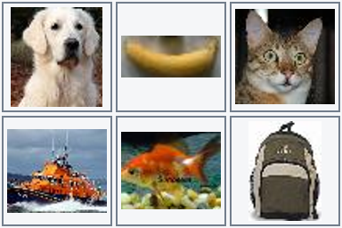

실제 모델에 들어간 사진판이다. 윗줄을 왼쪽부터 A·B·C, 아랫줄을 D·E·F라고 부르자. 아래 표는 각 칸의 중심 대상을 읽기 편하게 적은 것이다.

| | 왼쪽 | 가운데 | 오른쪽 |
|---|---|---|---|
| 윗줄 | A: 개 | B: 바나나 | C: 고양이 |
| 아랫줄 | D: 구명보트 | E: 금붕어 | F: 배낭 |

“고양이 사진을 골라”의 답은 C이다. “고양이에서 왼쪽으로 한 칸, 그다음 아래로 한 칸 이동해”라고 하면 C → B → E 순서로 따라가야 한다. “동물 사진이 세 장 이상이면 바나나를, 아니면 배낭을 골라”의 답은 B이다. 개, 고양이, 금붕어가 동물에 해당하기 때문이다.

이때 세는 것은 **동물이 나온 사진의 수**이다. 한 사진에 여러 동물이 있더라도 중심 대상 하나로 표현한다. 격자 밖으로 이동하거나 조건에 맞는 사진이 없으면 NONE을 선택한다. 출력 공간은 A, B, C, D, E, F, NONE의 일곱 가지이다.

## 2. 기본 모델과 우리가 학습하는 부분

기반 모델은 Qwen3.5-4B이다. 이 모델은 이미지와 텍스트를 함께 처리할 수 있다. 여기에 LoRA와 Clef 방식의 선택용 head를 붙였다. 입력 사진과 자연어 지시에서 표현을 계산한 뒤, 선택용 head가 각 선택지의 점수를 내는 구조이다.

Qwen이 사진과 지시를 함께 읽어 상황을 표현하면, 그 위에 붙인 Clef 방식의 head가 A부터 F, NONE까지 선택지별 점수를 만든다. 이 실험에서는 Qwen에 새로운 LoRA와 head를 붙여 학습한다. [실제 모델 생성 코드](../train.py)와 [배포 추론 코드](../engine.py)를 공개한다.

여기서 head를 조금 들여다보자. “B를 고른다”는 선택지는 단순한 번호가 아니라 “윗줄 가운데 사진을 고른다”는 뜻을 가진다. Head는 입력에서 질문과 선택지가 놓인 부분을 찾아, Qwen이 만든 표현과 함께 선택지별 점수를 계산한다. 이 head의 내부 폭은 512이며 routing 2층과 decoder 4층을 사용한다. [Head 참조 구현](../clef_reference.py)에서 구체적인 연산을 확인할 수 있다.

```text
2×3 사진 격자 + 자연어 지시 + 선택지 정의
                 ↓
       Qwen3.5-4B + 학습한 LoRA
                 ↓
          학습한 Clef head
                 ↓
         A B C D E F NONE 점수
```

앱에서 사진과 지시를 보내면 점수가 가장 높은 선택지가 답으로 나온다. E가 가장 높다면 프로그램은 응답 문장을 해석할 필요 없이 곧바로 “아랫줄 가운데”라는 결과를 받는다. 이때 각 선택지의 확률도 함께 얻을 수 있다.

이 장치에서 v2가 새 사진 문제 하나를 처리하는 시간의 중앙값은 약 157ms였다. CUDA에서 이미지 처리와 모델 계산, 확률 계산을 포함하고 모델을 처음 불러오는 시간은 뺀 수치다. [측정 기록](../results/v2/finetuned/report.json). 이 수치를 기억해 두자. 뒤에서 같은 96문제를 생성형 Qwen과 decision model에 각각 풀려 보고 시간도 직접 비교한다.

이제 모델이 올바른 칸에 높은 점수를 주도록 가르쳐 보자. 필요한 정답은 별도의 규칙 프로그램으로 만들어 둔다.

정답이 E인 문제를 생각해 보자. 모델이 E에 높은 점수를 주면 잘한 것이고, 다른 칸에 높은 점수를 주면 수정이 필요하다. 일곱 점수에 softmax를 적용한 확률을 p라고 하면, 정답 a에 대한 loss는 −log p(a)이다. 이 값을 줄이는 방향으로 LoRA와 head를 조금씩 바꾸는 것이 이번 지도학습의 핵심이다.

LoRA는 사전학습 가중치 W를 고정한 상태에서 작은 행렬 A, B를 학습하여 W + (alpha/r)BA 형태로 가중치의 변화를 표현한다. 이번에는 rank와 alpha를 모두 16으로 두었다. LoRA 32,464,896개와 선택용 head 32,046,596개를 학습하여 합계 64,511,492개가 학습 대상이다. 기본 모델·LoRA·head를 포함한 논리 파라미터 4,603,777,028개 중 약 1.40%에 해당한다.

기반 모델은 4bit로 읽어 GPU 메모리를 아꼈다. 압축해서 저장하더라도 원래 가중치의 논리적인 개수는 그대로이므로, 1.40%는 압축된 저장 크기가 아닌 전체 파라미터 수를 기준으로 계산한 값이다.

## 3. 사진보다 먼저 정해야 하는 의미

원본은 Tiny ImageNet이다. 200개 클래스 중 작은 사진에서도 대상이 비교적 분명한 40개 클래스를 사용하였다. 원본 bounding box로 중심 대상을 잘라 비율을 유지한 채 격자에 배치하고, 너무 작은 대상과 RGB가 완전히 같은 중복 사진을 제외하였다. 원본 해상도는 64×64이므로 확대하더라도 실제 세부 정보가 새로 생기는 것은 아니다.

사진마다 어떤 범주에 속하는지 명시적인 표를 만들었다. 예를 들어 금붕어는 물고기이면서 동물이다. 곰 인형은 동물 사진으로 세지 않는다. 이 정의가 불명확하면 “동물이 몇 장인가”라는 문장에 대해 정답부터 일관되지 않게 된다.

클래스 표본과 문장 틀은 코딩 에이전트가 검토했다. 사진 속 대상이 가려지거나 배경에 다른 물체가 함께 나오는 경우도 있다. 이런 장면에서 중심 대상이라는 기준이 얼마나 일관되게 적용되는지는 데이터 품질의 중요한 과제다.

## 4. 자연어와 정답을 함께 만드는 방법

먼저 문장과 독립적인 의미 프로그램을 만든다. 예를 들어 앞의 C → B → E 문제는 다음과 같이 쓸 수 있다.

```json
{"family":"chain","anchor":"cat","direction":"left","second_direction":"down"}
```

사진판의 대상 목록에 이 프로그램을 실행하여 정답을 구하고, 같은 프로그램을 여러 문장으로 표현한다. 같은 사진판에서 방향이나 대상을 바꿔 정답이 달라지는 문제 쌍도 만든다. 사진만 보고 답을 외우는 대신 지시의 차이에 주목하도록 하기 위해서다.

처음에는 일부 표현과 두 조건 조합을 따로 남겨 두고 나머지로 학습 문제를 만들었다. 처음 보는 문장이나 조합을 만났을 때 단순히 사진만 바뀐 경우와 얼마나 다른지 알아보기 위해서이다. 원본 사진 12,023장으로 격자 4,024개와 학습 예제 31,360개를 만들었고, 서로 다른 문장은 29,350개였다. 한 격자에 여러 지시를 붙이므로 사진 수와 예제 수는 다르다. [처음 데이터 집계](data-summary.json).

## 5. 처음 학습한 모델을 여러 방식으로 시험해 보자

첫 학습은 RTX 4070 Ti SUPER에서 135.7분 동안 진행했다. 학습 예제 31,360개를 사용해 batch 8로 4,400 step을 실행했고, 별도의 검증 문제에서 가장 좋았던 2,400 step 가중치를 골랐다. 이후 비교하기 쉽도록 이 첫 모델을 **v1**이라고 부르자. [학습 설정과 기록](TRAINING.md).

먼저 학습에서 보지 않은 사진으로, 배운 유형의 문제를 풀렸다. 1,120문제에서 **93.48%**를 맞혔다. 사진을 바꿔도 이 범위의 문제는 대체로 풀 수 있다는 결과이다. 그렇다면 같은 뜻을 다른 말로 물어도 괜찮을까? 또 배운 조건들을 새로운 순서로 엮으면 어떨까?

이를 시험하려고 같은 뜻을 다른 문장 구조로 표현한 질문과 여러 조건을 결합한 질문을 만들었다. 처음 모델은 이 문장 틀과 두 조건 조합을 학습하지 않았다. 가령 “고양이 왼쪽 사진”을 배운 뒤 “고를 사진 오른쪽에 고양이가 있어야 한다”고 묻는다. 조건 조합도 마찬가지다. 예를 들어 “고양이와 같은 행에 있는 과일을 골라”와 “사진에서 아래로 한 칸 이동해”라는 요소를 각각 익힌 모델에게, “고양이와 같은 행에서 과일 사진을 찾고, 그 과일의 바로 아래 사진을 골라”라고 묻는다. 같은 행에서 과일을 찾은 다음 그 위치를 출발점으로 삼아 한 칸 이동해야 한다. 아래 세 시험 모두 사진도 학습에 쓰지 않은 사진이며, 항목마다 1,120문제이다.

| 처음 모델에 준 시험 | 맞힌 문제 / 전체 문제 | 정확도 |
|---|---:|---:|
| 새 사진 + 같은 뜻을 바꿔 쓴 표현 | 888 / 1,120 | 79.29% |
| 새 사진 + 새로운 조건 조합 | 759 / 1,120 | 67.77% |
| 새 사진 + 바꿔 쓴 표현과 새로운 조건 조합 | 614 / 1,120 | 54.82% |

사진만 바꾼 93.48%보다 표현을 바꾸면 낮아지고, 조건을 조합하면 더 낮아졌다. 표현과 조합을 모두 바꾸면 절반을 조금 넘는다. 세 시험은 서로 다른 문제 집합이므로 차이를 특정 원인 하나의 순수한 효과로 단정할 수는 없다. 그래도 사용할 만한 표현과 조건이 학습에서 빠졌을 때 어디서 어려워지는지 살펴볼 근거는 된다. [처음 평가 기록](TRAINING.md).

이제 질문을 바꿔 보자. 실제 사용자가 입력할 것으로 예상하는 표현과 조건을 일부러 제외하지 않고 학습에 넣으면, 같은 사진 문제에서 얼마나 나아질까?

## 6. 부족했던 표현과 조건을 데이터에 넣어 보기

이번에는 지원할 12개 조건 유형에 한국어·영어 각각 6개의 문장 틀, 총 144개를 학습 데이터에 포함했다. “3장/세 장”, “3/three”, “왼쪽/좌측” 같은 표기도 섞었다. 방향·임계값·대상을 바꿨을 때 답이 달라지는 대조쌍도 만들었다. 이것을 모든 자연어를 망라한 데이터라고 보기는 어렵다. 지원 범위를 정하고 그 안의 예제를 보강한 것이다.

| 학습 데이터 | 처음 모델 | 보강한 데이터 |
|---|---:|---:|
| 원본 사진 | 12,023장 | 12,830장 |
| 2×3 사진판 | 4,024개 | 4,825개 |
| 지시·정답 예제 | 31,360개 | 37,632개 |
| 서로 다른 문장 | 29,350개 | 36,328개 |

사진 수는 각 버전 안의 고유 개수이다. 같은 학습 사진 풀을 사용하므로 두 열을 더해 전체 고유 사진 수로 삼으면 안 된다. 원본 사진 ID와 RGB hash를 기준으로 학습·검증·보정·평가를 분리했고, 기존 평가 사진은 보강 학습에도 넣지 않았다. [데이터 구성과 검사](V2_DATA_CARD.md).

이 데이터를 사용해 처음 모델의 LoRA와 head를 이어서 학습했다. 이 두 번째 모델을 **v2**라고 부르자. 처음부터 새 모델을 학습한 것이 아니고, 바뀐 것은 학습 데이터와 이어서 학습한 가중치이다. 따라서 비교 결과만으로 데이터 변화와 추가 학습량 각각의 독립적인 효과를 분리할 수는 없다.

## 7. 한 에폭의 의미와 실제 학습

이번 v2는 사전학습 모델에서 곧바로 시작한 첫 학습이 아니다. v1에서 검증으로 선택한 step 2,400의 LoRA와 head에서 이어서 학습한다. 계획한 추가 학습량은 37,632개 예제, batch 8, 4,704 step으로 1 epoch이다.

한 epoch는 각 예제를 한 번씩 사용하는 단위이다. 같은 원리를 한 번만 본다는 뜻은 아니다. 조건 유형 하나당 3,136개 예제가 있으며, 서로 다른 사진과 표현에서 같은 원리를 반복하게 된다. 가중치도 한 epoch 안에서 4,704번 업데이트한다.

기반 VLM은 이미 이미지·언어에 관한 큰 규모의 학습을 거친 상태이다. 예전 ImageNet 분류 사전학습이 주로 시각 특징을 전달했다면, VLM은 이미지와 언어의 대응 및 지시 처리 능력도 가져온다. 적은 추가 학습으로 이 작업에 적응할 수 있는 이유로 생각할 수 있다. 다만 초기 실험만으로는 사전학습의 기여를 분리하기 어렵다. 뒤에서 순수 Qwen도 같은 문제의 일부에 실행해 비교한다. LoRA 역시 적은 epoch로 충분하다는 보증이 아니라 파라미터 효율적인 적응 방법이다.

실제 장비는 Windows의 RTX 4070 Ti SUPER 16 GB 한 장, Ryzen 7 9800X3D, RAM 64 GB이다. NF4 4bit로 기본 모델을 읽고 BF16으로 계산한다. LoRA 학습률은 1e-4, head 학습률은 5e-5이며 cosine schedule을 사용한다.

실제 추가 학습은 148.1분 동안 진행되었다. Trainer 기록 기준이며, 사전 다운로드·데이터 생성·최종 평가 시간은 제외한다. v1의 전체 run 135.7분과 별개인 추가 시간이다. 고정 검증 336개에서 가장 높았던 step 3,600의 가중치를 배포한다. 최고 점수가 같으면 먼저 저장된 체크포인트를 유지한다.

| 항목 | 실제 기록 |
|---|---|
| 장비 | NVIDIA GeForce RTX 4070 Ti SUPER · Windows · RAM 약 64 GB |
| 추가 학습 예제 | 37,632개 |
| 추가 학습 완료 | 4,704 step · 1.00 epoch |
| Trainer 실행 시간 | 148.1분 |
| 선택한 배포 체크포인트 | v2 step 3,600 |
| 선택 시점까지 v2 예제 제시 | 28,800회 |
| 고정 검증 336개에서 선택 점수 | 97.62% |
| 최대 PyTorch 할당 / 예약 | 6.20 / 7.06 GiB |

v1의 부모 체크포인트는 step 2,400에서 선택되어 19,200회의 예제 제시를 반영했다. v2 배포 체크포인트는 거기서 28,800회를 추가로 본 상태이다. 데이터셋이 바뀌었으므로 두 단계의 epoch를 단순히 더하지 않는다. 전체 run이 1 epoch를 완료했더라도 이후 step의 업데이트가 앞서 선택된 배포 가중치에 포함되는 것은 아니다.


위 그림의 loss는 기록된 logging 간격의 값과 20개 기록의 이동평균이다. 아래 검증 곡선은 학습에 넣지 않은 검증 사진으로 계산했다. 전체 점수만 보고 새로운 조합의 개선을 추정하지 않고, 다음 절에서 실제 같은 평가 문제끼리 비교한다. [설정](v2/training-config.json), [전체 loss 기록](v2/training-history.json), [검증 추이](v2/validation-history.json), [실제 시간·메모리](v2/training-metrics.json).

## 8. 무엇이 얼마나 좋아졌는가

이제 앞에서 어려움을 확인했던 세 평가 문제를 그대로 다시 풀려 보자. 사진·문장·정답이 동일한 1,120개씩을 사용한다.

| 기존 평가 구분 | v1 | v2 최종 | 변화 |
|---|---:|---:|---:|
| 새 사진 + 같은 뜻을 바꿔 쓴 표현 | 79.29% | **95.71%** | **+16.43%p** |
| 새 사진 + 새로운 조건 조합 | 67.77% | **95.71%** | **+27.95%p** |
| 새 사진 + 바꿔 쓴 표현과 새로운 조건 조합 | 54.82% | **95.62%** | **+40.80%p** |

세 항목 모두 약 95.6~95.7%까지 올랐다. 이 숫자를 읽기 전에 시험과 학습 데이터의 관계를 짚고 가자. **틀린 시험 문제와 그 사진을 그대로 학습에 넣은 것은 아니다.** v1의 시험 결과를 보고 어떤 표현과 조건 조합이 어려운지 확인한 다음, 같은 문장 틀과 조건 유형을 다른 학습 사진으로 만든 예제에 넣어 v2를 보강했다. 사진 원본 ID와 이미지 해시를 기준으로 학습용과 시험용 사진이 겹치지 않도록 나눴다.

따라서 이 표는 **학습한 표현과 조건을 새로운 사진에 적용하는 능력**이 얼마나 좋아졌는지를 보여 준다. 반면 v2가 **처음 보는 표현이나 조건 조합**에도 잘 일반화하는지는 이 표로 판단할 수 없다. 그 유형들을 이미 v2 학습에 포함했기 때문이다. 또 v1의 시험 결과가 데이터 보강 방향에 영향을 주었으므로, 이 시험은 완전히 독립적인 최종 시험보다 보강 전후를 비교하는 시험으로 읽는 편이 정확하다. 새로운 표현·조합에 대한 일반화를 보려면 그 둘과 사진을 모두 분리한 새 시험이 필요하다. [전체 시험 문제와 사진 배치 기록](v2/TEST_CASES.md).


세 항목은 각각 같은 1,120개 문제를 사용하며, 전체 예측의 사진 ID·문장·정답이 일치하는지 코드로 검사하였다. [기존 문제 전후 비교 JSON](../results/v2/original-suite-comparison.json)과 [문제별 실제 예측](../results/v2/finetuned/)에서 확인할 수 있다.

별도로 모든 유형을 균형 있게 포함한 v2_test 2,016문제에서는 v1 **84.52% → v2 95.78%** 결과를 보였다. 한국어는 84.33% → 95.63%, 영어는 84.72% → 95.93%였다. 이 집계는 위의 세 항목과 다른 문제 집합이다. 서로 다른 표의 전후 점수를 섞어서 개선 폭을 계산하지 않는다. [동일 2,016문제 비교](../results/v2/comparison.json).

### 실제 사진에서 달라진 선택

숫자만 보면 어떤 문제가 달라졌는지 감이 잘 오지 않는다. 실제 사진판을 꺼내 보자. 각 평가에서 한국어 문제 중 v1은 틀리고 v2는 맞힌 첫 사례를 가져왔다. 질문과 두 모델의 답은 저장된 평가 기록 그대로다.

#### 표현을 바꿔 물은 경우

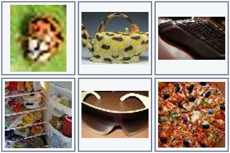

> 다음 조건에 맞춰 사진을 골라 줘. 주방용품 사진을 찾되, 그 사진의 바로 아래쪽에 선글라스 사진이 있어야 해. 칸을 벗어나는 이동은 NONE으로 답해.

정답 **B** · v1 **E** → v2 **B**

선글라스는 E에 있다. 바로 위 칸 B의 주전자는 주방용품이며, 그 바로 아래에 선글라스가 있으므로 B가 정답이다.

사진판 `test_language-00056` · [v1 실제 예측](../results/test_language_predictions.json) · [v2 실제 예측](../results/v2/finetuned/test_language_predictions.json)

#### 조건 두 개를 이어서 물은 경우

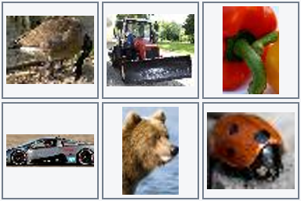

> 부탁 하나 할게. 트랙터 사진과 같은 행의 음식 사진을 찾고, 그 사진에서 왼쪽으로 한 칸 이동한 사진을 골라.

정답 **B** · v1 **A** → v2 **B**

트랙터 B와 같은 윗줄에서 음식 사진을 찾으면 C의 피망이다. C에서 왼쪽으로 한 칸 이동하면 B가 된다.

사진판 `test_composition-00095` · [v1 실제 예측](../results/test_composition_predictions.json) · [v2 실제 예측](../results/v2/finetuned/test_composition_predictions.json)

#### 표현과 조건 조합을 함께 바꾼 경우

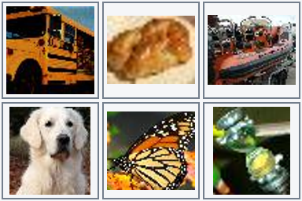

> 부탁 하나 할게. 이동을 시작할 칸은 나비 사진과 같은 행에 있는 곤충 사진이야. 거기서 왼쪽으로 한 칸 이동해.

정답 **D** · v1 **E** → v2 **D**

나비는 E에 있다. 같은 아랫줄의 곤충도 E의 나비이므로 E에서 출발한다. 왼쪽으로 한 칸 이동한 D의 개가 정답이다.

사진판 `test_combined-00031` · [v1 실제 예측](../results/test_combined_predictions.json) · [v2 실제 예측](../results/v2/finetuned/test_combined_predictions.json)

학습 중에는 각 항목에서 56문제를 골라 중간 결과도 살펴봤다. 전체 1,120문제로 계산한 위 표가 최종 비교이고, 중간 표본은 학습 과정에서 변화가 어떻게 나타나는지 살펴보는 자료다.

### 틀렸던 시험 문제와 보강 데이터 나란히 보기

위에서 본 세 문제를 v2 학습 데이터의 실제 예제와 나란히 놓아 보자. 각 평가에서 v1은 틀리고 v2는 맞힌 첫 한국어 문제를 고르고, 같은 조건 유형과 문장 틀의 학습 예제를 짝지었다. 사진과 대상은 어떻게 바뀌고 질문의 구조는 어떻게 닮았는지 살펴보자.

**같은 뜻을 바꿔 쓴 표현**

시험 사진판 `test_language-00056`:


- 시험 질문: “다음 조건에 맞춰 사진을 골라 줘. 주방용품 사진을 찾되, 그 사진의 바로 아래쪽에 선글라스 사진이 있어야 해. 칸을 벗어나는 이동은 NONE으로 답해.”
- 정답 **B** · v1 **E** · v2 **B**

보강 학습 데이터의 사진판 `v2_train-04308`:

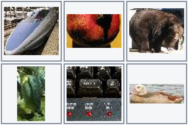

- 학습 지시: “이 사진판을 보고 답해 줘. 전기나 전자로 작동하는 기기 사진을 찾되, 그 사진의 바로 우측에 거위 사진이 있어야 해. 칸을 벗어나는 이동은 NONE으로 답해.”
- 학습 정답: **E**

**새로운 조건 조합**

시험 사진판 `test_composition-00095`:


- 시험 질문: “부탁 하나 할게. 트랙터 사진과 같은 행의 음식 사진을 찾고, 그 사진에서 왼쪽으로 한 칸 이동한 사진을 골라.”
- 정답 **B** · v1 **A** · v2 **B**

보강 학습 데이터의 사진판 `v2_train-03936`:

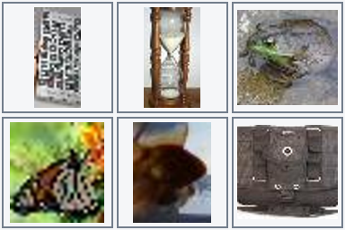

- 학습 지시: “백팩 사진과 같은 행의 곤충 사진을 찾고, 그 사진에서 위쪽으로 한 칸 이동한 사진을 골라. 해당하는 사진이 없으면 NONE이야.”
- 학습 정답: **A**

**바꿔 쓴 표현과 새로운 조건 조합**

시험 사진판 `test_combined-00031`:


- 시험 질문: “부탁 하나 할게. 이동을 시작할 칸은 나비 사진과 같은 행에 있는 곤충 사진이야. 거기서 왼쪽으로 한 칸 이동해.”
- 정답 **D** · v1 **E** · v2 **D**

보강 학습 데이터의 사진판 `v2_train-02693`:

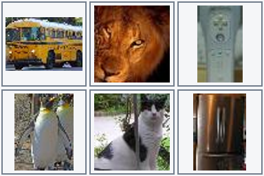

- 학습 지시: “다음 조건에 맞춰 사진을 골라 줘. 이동을 시작할 칸은 펭귄 사진과 같은 행에 있는 전기나 전자로 작동하는 기기 사진이야. 거기서 왼쪽으로 한 칸 이동해. 해당하는 사진이 없으면 NONE이야.”
- 학습 정답: **E**

각 쌍은 조건 유형과 문장 틀을 공유하지만 사진 원본은 겹치지 않는다. 시험에서 틀린 사진 문제를 그대로 학습에 복사한 것이 아니라, 그와 닮은 표현과 조건을 다른 사진으로 연습하도록 데이터를 보강한 것이다. 이 예제들은 전체 v2 학습 데이터에서 뽑았으며, 배포 체크포인트가 선택된 시점까지 개별 예제가 실제로 제시됐는지는 여기서 확인하지 않았다. 세 쌍은 변화를 이해하기 위한 사례이며 전체 성능은 위의 1,120문제씩으로 살펴봐야 한다.

이 비교는 학습한 유형을 새 사진에 적용한 결과다. 처음 보는 문장 구조나 조건 조합으로도 잘 되는지는 별도의 새로운 평가셋이 필요하다. [사진 출처와 질문·정답 원본](v2/training-evaluation-examples.json)에서 각 쌍을 확인할 수 있다.

## 9. 전체 정확도만으로 알 수 없는 것

대상 찾기, 두 단계 이동, 개수 분기, 범주별 개수 비교는 서로 다른 어려움이 있다. 아래 표는 별도 v2_test 2,016문제에서 계산한 조건별 결과이다. 조건마다 168문제이며, 위의 기존 세 항목 표와 구분한다.

| 조건 유형 | 예시 지시 (실제 평가 문장) | v1 | v2 |
|---|---|---:|---:|
| 같은 행에서 제외 | <ul><li>석류가 있는 가로줄에서 음식에 해당하지 않는 사진을 선택해.</li><li>나비 사진과 같은 행에서 어류 사진을 제외하고 남는 사진을 골라.</li><li>곤충 사진이 아니면서 선글라스 사진과 같은 행에 있는 사진을 찾아.</li></ul> | 85.71% | 97.02% |
| 이동한 칸의 행에서 범주 찾기 | <ul><li>거위에서 아래로 한 칸 간 다음, 도착한 행에서 음식 사진을 찾아.</li><li>금붕어의 우측 이웃 칸을 기준으로 같은 가로줄의 과일 사진을 선택해.</li><li>금붕어의 좌측 이웃 칸을 기준으로 같은 가로줄의 과일 사진을 선택해.</li></ul> | 90.48% | 97.02% |
| 이동한 칸의 열에서 범주 찾기 | <ul><li>기차 사진의 바로 좌측 칸과 같은 열에 있는 배 사진을 골라.</li><li>거위의 위 이웃 칸을 기준으로 같은 세로줄의 조류 사진을 선택해.</li><li>거위의 아래 이웃 칸을 기준으로 같은 세로줄의 조류 사진을 선택해.</li></ul> | 93.45% | 99.40% |
| 두 단계 이동 | <ul><li>개구리를 찾고 위 한 칸 간 다음 우측 한 칸 가 줘.</li><li>석류를 찾고 왼쪽 한 칸 간 다음 위쪽 한 칸 가 줘.</li><li>황소개구리를 찾고 위 한 칸 간 다음 좌측 한 칸 가 줘.</li></ul> | 88.10% | 99.40% |
| 대상 찾기 | <ul><li>돼지가 보이는 칸을 선택해 줘.</li><li>부탁 하나 할게. 돼지 사진을 골라.</li><li>부탁 하나 할게. 콜리플라워 사진을 골라.</li></ul> | 89.29% | 91.07% |
| 같은 열의 범주 | <ul><li>금붕어 사진과 같은 열에 있는 어류 사진을 골라.</li><li>동물 사진 중 나비 사진과 세로줄이 같은 것은 어디 있어?</li><li>먹거리 사진 중 금붕어 사진과 세로줄이 같은 것은 어디 있어?</li></ul> | 94.05% | 98.81% |
| 개수 기준 분기 | <ul><li>어류 사진이 3장 이상이면 바나나 사진을, 아니면 펭귄 사진을 골라.</li><li>세 장 이상의 주방용품 사진이 있으면 개를 찾아줘. 그렇지 않으면 우산을 찾아줘.</li><li>포유류 사진 개수가 1 이상일 때는 우산, 그 외에는 석류. 해당 사진은 어디야?</li></ul> | 79.17% | 88.69% |
| 인접 위치와 범주 | <ul><li>개구리 사진의 바로 아래에 있는 과일 사진을 골라.</li><li>동물 사진이 개 사진의 바로 왼쪽에 있으면 선택해.</li><li>리모컨 사진의 바로 아래에 있는 동물 사진을 골라.</li></ul> | 85.12% | 99.40% |
| 인접 위치 | <ul><li>주판 사진과 우측으로 바로 이웃한 사진은 어느 칸이야?</li><li>주판 사진과 좌측으로 바로 이웃한 사진은 어느 칸이야?</li><li>무당벌레를 찾은 다음, 그 칸에서 왼쪽으로 한 칸 가 줘.</li></ul> | 87.50% | 97.62% |
| 같은 행의 범주를 찾은 뒤 이동 | <ul><li>먼저 선글라스의 행에 있는 동물 사진을 찾아. 그 칸의 위쪽 이웃을 골라줘.</li><li>스포츠카가 있는 가로줄에서 곤충 사진을 찾은 뒤 그 바로 아래쪽 사진을 선택해.</li><li>티포트가 있는 가로줄에서 먹거리 사진을 찾은 뒤 그 바로 아래쪽 사진을 선택해.</li></ul> | 44.64% | 95.83% |
| 범주별 개수 비교 | <ul><li>배 사진 수가 먹거리 사진 수 이상이면 곰 사진을 골라. 그렇지 않을 때는 구명보트 사진이야.</li><li>부탁 하나 할게. 포유류 사진이 물고기 사진보다 많으면 찻주전자, 아니면 고양이 사진을 골라.</li><li>곤충 사진 수와 물고기 사진 수를 비교해. 앞쪽이 더 많을 때만 금붕어, 나머지는 키보드를 선택해.</li></ul> | 82.74% | 88.10% |
| 같은 행의 범주 | <ul><li>개 사진과 같은 행에 있는 새 사진을 골라.</li><li>코알라가 있는 가로줄에서 포유류 사진을 찾아줘.</li><li>고양이가 있는 가로줄에서 수상 운송수단 사진을 찾아줘.</li></ul> | 94.05% | 97.02% |

정확도가 오른 뒤에도 틀린 문제는 남는다. 기존 세 평가 파일에서 처음 등장한 오답을 하나씩 살펴보자. 사진 ID와 실제 예측은 연결된 기록에서 따라갈 수 있다.

- `test_language`: “부탁 하나 할게. 고를 사진은 먹거리 사진이면서 이집트고양이 사진과 행이 같아야 해. 해당하는 사진이 없으면 NONE이야.” → 정답 **A**, 예측 **NONE**. 사진판 ID `test_language-00106`.
- `test_composition`: “First find ladybug, then step one tile to the left. Which fish photo shares that column? Choose NONE if no tile qualifies.” → 정답 **NONE**, 예측 **A**. 사진판 ID `test_composition-00003`.
- `test_combined`: “부탁 하나 할게. 포유류 사진을 고르되, 고양이에서 오른쪽 한 칸 이동해서 도착한 열 안에서 찾아야 해. 해당하는 사진이 없으면 NONE이야.” → 정답 **NONE**, 예측 **C**. 사진판 ID `test_combined-00001`.

### 틀린 답도 사진과 함께 보기

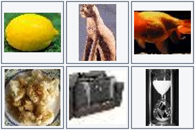

> 부탁 하나 할게. 고를 사진은 먹거리 사진이면서 이집트고양이 사진과 행이 같아야 해. 해당하는 사진이 없으면 NONE이야.

정답 **A** · v2 **NONE**

고양이 B와 같은 윗줄에는 먹거리인 레몬 A가 있다. 따라서 정답은 A인데 v2는 조건에 맞는 사진이 없다는 NONE을 선택했다. 사진판 `test_language-00106`는 위 목록의 첫 오답과 같은 사례이다. 선택 결과만으로는 사진 인식과 문장 해석 중 어느 단계에서 실패했는지 단정할 수 없다. [실제 예측 기록](../results/v2/finetuned/test_language_predictions.json).

사진 출처는 Stanford Tiny ImageNet이다. 위에 실은 다섯 사진판의 원본 사진 ID, 복사 전후 SHA-256과 사례 선택 기준은 [사진 출처·예측 기록](v2/photo-examples.json)에 남겼다. 사진의 권리는 원 소유자에게 있으며, 프로젝트 코드의 Apache-2.0 라이선스가 사진에 적용되지는 않는다.

구어체로 작성한 14개 시연 문제도 있었다. 같은 사진판에서 v1은 12개, v2는 11개를 맞혔다. 특히 개수와 비교 조건을 말하듯 바꾼 질문에서 오답이 남았다. 한 사진판의 작은 시연이지만, 앞의 표가 좋아진 뒤에도 다음에 보완할 표현을 찾는 데 도움이 된다. [구어체 실제 예측](../results/v2/freeform.json).

### 직접 입력해 본 세 화면

같은 사진판에서 사용자가 동물 사진의 기준을 1장, 2장, 3장으로 바꿔 본 화면이다. A에는 초록색 음식, B에는 금붕어, E에는 동물 사진이 보인다. 기준이 1장이나 2장일 때는 적어도 B와 E 두 장이 동물이므로 A가 자연스러운 답이다. 화면에는 두 경우 모두 F가 표시되었다. 세 번째 화면에는 NONE이 표시되어 있다.

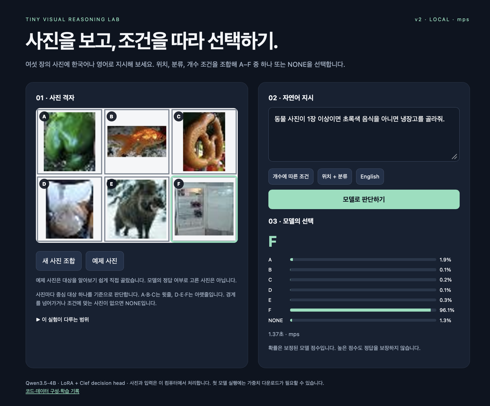

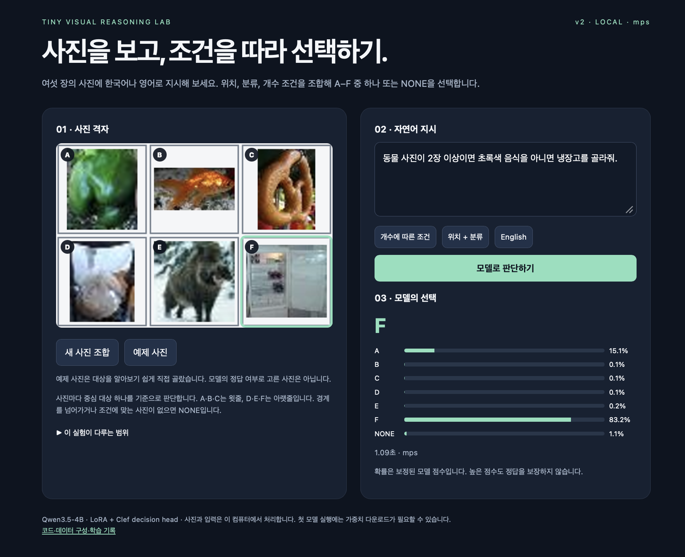

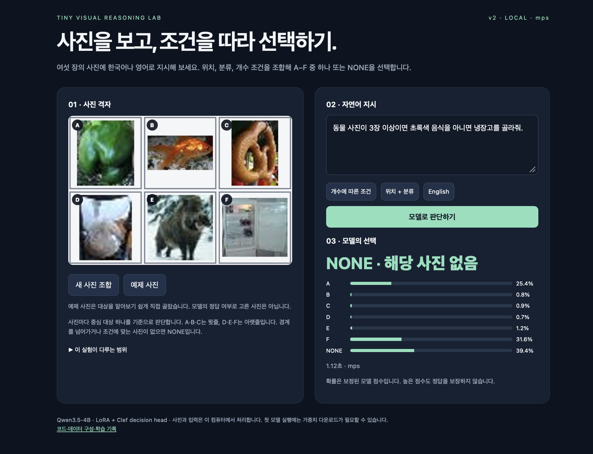

첫 화면에서 F의 표시 확률은 96.1%, 두 번째는 83.2%였다. 높은 점수를 받은 선택도 사진과 조건을 함께 확인할 필요가 있다는 사례다. 스크린샷에는 입력란과 선택 결과가 함께 담겨 있지만, 질문을 바꾼 뒤 매번 판단 버튼을 다시 눌렀는지는 화면만으로 확인할 수 없다. 세 번째의 흐릿한 D 사진의 중심 대상을 확정할 원본 기록도 없어, 그 경우의 정답은 여기서 단정하지 않겠다. 화면에 표시된 MPS 실행 시간은 1.37초, 1.09초, 1.12초이며 아래의 Windows GPU 비교와는 장비와 측정 맥락이 다르다.

저장한 가중치를 다시 읽어도 같은 판단이 나올까? 24개 검증 표본에서 학습용 구현, 배포 CUDA, CPU의 선택이 모두 일치했다. 검증 336개 전체의 정확도도 학습용과 배포 CUDA 모두 97.62%였다. [재로딩 검사](v2/reload-final.json).

답만큼 확률도 살펴볼 만하다. 모델이 너무 확신하는 경향을 조정하려고 별도의 1,008개 문제로 temperature를 1.8302로 맞췄다. 점수를 같은 양수로 나누므로 선택 자체는 유지되고 확률의 크기가 달라진다. 보정에 사용한 문제에서 negative log-likelihood는 0.1997에서 0.1420으로 줄었다. [보정 기록](v2/logs/calibration/v2.json).

남은 질문은 분명하다. 이번에 보강한 문장 틀 밖에서 질문을 바꾸면 어떻게 될까? 그 답을 얻으려면 새로운 표현과 사진을 따로 준비해 다시 시험해야 한다. 기반 모델의 ImageNet 노출이나 근접 중복 여부도 이번 기록만으로는 확인할 수 없다.

## 10. 이 실험에서 배운 것

처음 모델은 새로운 사진에서 배운 유형의 문제를 잘 풀었지만, 표현과 조건을 함께 바꾸자 54.82%까지 내려갔다. 빠진 유형을 포함해 이어서 학습한 뒤 같은 문제에서는 95.62%를 얻었다. 어려운 사례가 무엇인지 알아보고, 그 사례를 가르칠 데이터를 만드는 과정이 개선의 출발점이었다.

이미 이미지와 언어를 함께 다뤄 본 기반 모델이 있어 우리는 사물을 처음부터 가르치는 대신, 사진과 지시를 특정 선택에 연결하는 작업에 집중할 수 있었다. 뒤에서는 기본 Qwen에도 같은 문제 일부를 직접 물어본다. 다만 그 비교에서는 출력 방식과 추가 학습 여부가 함께 달라지므로, 사전학습의 기여만 따로 떼어 볼 수는 없다.

예제 하나를 한 번 봤다는 것과 판단 규칙을 한 번만 연습했다는 것은 다르다. 예를 들어 “고양이의 오른쪽 사진”과 “개구리의 오른쪽 사진”은 서로 다른 예제지만, 둘 다 기준 사진에서 오른쪽으로 한 칸 이동하는 연습이다. 사진과 대상, 문장을 바꿔 같은 종류의 판단을 여러 번 연습하도록 데이터를 만들었다.

v2 추가 학습은 37,632개 예제를 한 바퀴 도는 4,704 step까지 진행했다. 하지만 최종 모델은 마지막 가중치가 아니라 별도의 검증 문제에서 성능이 가장 좋았던 3,600 step의 가중치다. 이 시점까지 모델에 예제가 제시된 횟수는 3,600 × 8 = 28,800회다. 여기에 v1을 학습하며 익힌 내용도 이미 들어 있다. 두 차례 중간 표본 검사에서도 항목별 변화가 엇갈렸다. 1,600 step에서 2,000 step으로 갈 때 새 표현은 한 문제 더 맞혔지만, 표현·조합에서는 두 문제를 더 틀렸다. [중간 평가 기록](../results/v2/interim-step-1600.json), [두 번째 기록](../results/v2/interim-step-2000.json). 각 표본은 56문제이며 v2는 CPU, 저장된 v1 예측은 CUDA였다.

가장 흥미로운 점은 원하는 판단의 형태를 데이터로 구체화할 수 있다는 것이다. “위치를 이해해라”라고 막연히 요구하는 대신 방향을 바꾼 두 질문과 각각의 정답을 보여 준다. 다만 14개 구어체 시연의 결과가 보여 주듯, 다음에 다루고 싶은 표현을 찾고 별도의 문제로 다시 시험하는 일도 계속 필요하다.

## 생성형 Qwen에게 생각할 시간을 더 주면?

앞에서 만든 decision model은 일곱 선택지의 점수를 한 번에 계산한다. 그렇다면 Qwen에게 같은 사진과 질문을 보여 주고, 채팅하듯 정답을 글자로 직접 쓰게 하면 어떨까? 이 방식에서는 모델이 다음 토큰을 하나씩 생성해 답을 완성한다. 두 방식의 정확도와 시간을 같은 문제로 비교해 보자.

먼저 기본 Qwen에 A–F 또는 NONE으로 답하라고 요청하고 생각 모드를 끈 채 최대 8토큰을 주었다. 일부 출력은 설명을 시작하다가 답을 끝내지 못했다. 토큰을 더 주거나 생각 모드를 켜면 결과가 달라질까?

`v2_test`에서 뽑은 **96문제**로 네 설정을 추가로 시험했다. 12개 작업 유형과 한국어·영어에서 각각 네 문제씩 고른 표본이며, 사진 파일 해시와 질문·정답이 앞선 비교와 일치한다. 생성형은 파인튜닝하지 않은 Qwen3.5-4B, decision model은 같은 기반 모델에서 추가 학습한 v2이다. 모두 RTX 4070 Ti SUPER에서 NF4 4bit/BF16으로 실행했다.

v2는 여기서 평가하는 작업 유형과 문장 틀을 학습했다. 평가에 쓰인 사진은 v2 학습에서 제외했다. 같은 사진판이 여러 문제에 쓰이는 96문제이므로, 서로 독립적인 사진 96장에 대한 결과로 해석하지 않는다.

생성형에게 매번 같은 질문과 A–F 또는 NONE으로 답하라는 지시를 주고, 토큰 한도를 40과 120으로 바꾸었다. 각각 Qwen의 생각 모드를 끈 경우와 켠 경우를 실행했으며, 네 조건 모두 무작위 샘플링 없이 결정적으로 생성했다.

| 모델·설정 | 엄격 정답 | 형식 허용 정답 | 최종 답 미인식 | 한도 도달 | 중앙 시간 |
|---|---:|---:|---:|---:|---:|
| decision model v2 | 93/96 (96.88%) | 같은 값 | 0 | 해당 없음 | 157.1ms |
| 생성형 · 생각 끔 · 8토큰 (기존) | 29/96 (30.21%) | 30/96 (31.25%) | 4 | 기록 없음 | 226.7ms |
| 생성형 · 생각 끔 · 40토큰 | 29/96 (30.21%) | 30/96 (31.25%) | 3 | 3 | 243.7ms |
| 생성형 · 생각 켬 · 40토큰 | 0/96 (0.00%) | 0/96 (0.00%) | 96 | 96 | 1597.9ms |
| 생성형 · 생각 끔 · 120토큰 | 29/96 (30.21%) | 30/96 (31.25%) | 3 | 3 | 239.9ms |
| 생성형 · 생각 켬 · 120토큰 | 0/96 (0.00%) | 0/96 (0.00%) | 96 | 96 | 4613.3ms |

먼저 생각을 끈 두 조건을 보면, 형식을 조금 허용했을 때 40토큰에서 30개, 120토큰에서 30개를 맞혔다. 생각을 켠 경우에는 40토큰에서 0개, 120토큰에서 0개가 생각 구간을 닫고 답변 단계에 도달했다. 한도 안에 답이 나오지 않은 문제는 점수 계산에서 오답이 되므로, 이 숫자와 정답 수를 함께 봐야 한다. 특히 여기의 0/96은 **한도 안에 채점할 최종 답을 얻지 못했다**는 뜻이다. 시간을 더 줬을 때 생각의 결론이 맞을지 틀릴지는 이 결과만으로 알 수 없다.

엄격 정답은 최종 출력이 A–F 또는 NONE 하나인 경우만 인정한다. 형식 허용 정답은 `정답: B`, `Answer: B`도 읽는다. 최종 답이 형식에 맞지 않거나 끝내 나오지 않으면 정답 수에서는 오답으로 계산했다. 한도 도달은 EOS 종료 토큰을 내기 전에 최대 생성 토큰 수에 이른 경우다. 표의 미인식과 한도 도달은 겹칠 수 있다.

생각 모드의 출력은 `</think>` 뒤에 나온 최종 답만 채점했다. 생각 중간에 쓰인 A나 B는 답으로 세지 않았다. 생각 구간을 닫지 못해 최종 답변을 찾지 못한 수는 생각 끔·40토큰 0개, 생각 켬·40토큰 96개, 생각 끔·120토큰 0개, 생각 켬·120토큰 96개다. 생각 끔은 답변 단계에서 시작한다.

시간은 세 문제의 준비 실행 뒤, 이미지를 연 상태에서 전처리·모델 계산·결과 변환을 포함해 GPU 완료까지 잰 중앙값이다. 모델 로딩과 파일 읽기·HTTP 시간은 빠져 있다. 기존 8토큰과 decision 값은 앞선 별도 실행에서 잰 값이며 네 새 조건은 이후 같은 컴퓨터에서 측정했다. 긴 출력을 생성하는 조건에서는 그 토큰을 생성하는 시간도 들어간다.

표에서 비교한 두 모델은 답을 내는 방식뿐 아니라 학습 정도도 다르다. 생성형은 기본 Qwen 그대로이고, decision model은 LoRA와 선택용 head를 추가로 학습했다. 따라서 정확도 차이를 선택 방식만의 효과로 보기는 어렵다. 또 생각 모드에 준 40·120토큰은 최종 답에 도달하기 전의 생각에도 사용된다. 다른 프롬프트나 더 긴 한도에서는 결과가 달라질 수 있으므로, 각 조건의 원문과 종료 상태를 함께 살펴보자.

### 그래서 언제 decision model이 유용할까?

내가 이 결과에서 주목하는 것은 **판단의 목적이 정해져 있을 때, 큰 모델의 능력을 그 목적에 맞는 작은 출력으로 연결할 수 있다**는 점이다. 이 실험에서 필요한 것은 사진에 대한 긴 설명이 아니라 A–F 또는 NONE 중 하나다. 선택 점수가 나오면 프로그램은 문장에서 답을 다시 찾아낼 필요 없이 바로 다음 동작으로 넘길 수 있고, 일곱 선택지의 점수도 함께 살펴볼 수 있다.

같은 96문제에서 추가 학습한 decision model은 93개를 맞혔고 중앙 시간은 157.1ms였다. 생각을 끈 기본 Qwen은 `정답: B` 같은 답도 인정하면 30개를 맞혔고, 40토큰 설정의 중앙 시간은 243.7ms였다. 이 측정에서는 decision model이 약 1.55배 빨랐다. 두 모델의 학습 여부도 다르므로 정확도 차이를 head 하나의 효과로 돌릴 수는 없지만, **이 작업을 수행하는 두 모델을 그대로 써 봤을 때 어떤 결과가 나왔는지**는 확인할 수 있다.

학습 비용도 이 방식의 매력이다. 사진과 언어를 이미 배운 Qwen을 기반으로, 전체 논리 파라미터의 약 1.40%에 해당하는 LoRA와 head를 학습했다. v1을 만든 뒤 v2에서 필요한 표현과 조건을 보강하는 데 이 컴퓨터의 GPU 한 장으로 148.1분이 걸렸다. 이 시간은 v2의 추가 학습 시간이고, 그 전에 v1 학습 135.7분과 데이터 제작·평가도 필요했다. 그래도 새 작업에 맞는 예제를 마련해 기존 모델을 비교적 짧은 시간에 적응시킬 수 있다는 점은 실용적이다.

물론 모든 질문에 고정된 선택지가 있는 것은 아니다. 설명을 듣거나 예상하지 못한 질문을 주고받는다면 생성형 모델이 더 자연스럽다. 반대로 로봇이 집을 물건이나 화면에서 누를 위치처럼 **가능한 행동이 정해진 문제**라면, 내가 원하는 판단을 예제로 가르치고 선택 결과를 바로 받는 decision model을 고려해 볼 만하다. 이번 실험은 그 가능성을 작은 사진 선택 문제에서 확인한 첫걸음이다.

[생각 끔 · 40토큰](../results/generative-comparison/thinking-0-tokens-40.json) · [생각 켬 · 40토큰](../results/generative-comparison/thinking-1-tokens-40.json) · [생각 끔 · 120토큰](../results/generative-comparison/thinking-0-tokens-120.json) · [생각 켬 · 120토큰](../results/generative-comparison/thinking-1-tokens-120.json) · [비교 요약](../results/generative-comparison/reasoning-summary.json) · [평가 코드](../compare_reasoning_modes.py) · [기존 8토큰 출력](../results/generative-comparison/generative.json).

## 11. 가중치의 출처와 다시 실행하기

직접 실행할 때는 파일이 어디서 오는지 알아 두면 편하다. 기본 Qwen 모델은 Hugging Face에서, 학습한 LoRA·head와 보정값은 이 프로젝트의 GitHub Release에서 받는다. 사진은 Stanford의 Tiny ImageNet에서 따로 받는다.

첫 실행 후 빨라지는 것은 저장된 기본 모델과 학습 가중치를 다시 사용하기 때문이다. 실행할 때마다 학습을 다시 하는 구조가 아니다.

| 구성 | 출처와 크기 |
|---|---|
| 기본 VLM | Hugging Face `Qwen/Qwen3.5-4B`, 원본 snapshot 약 9.34 GB |
| 학습한 LoRA·head·processor·보정값 | GitHub `model-v2`, 174,218,456 bytes |
| 원본 사진 데이터 | Stanford Tiny ImageNet, 248,100,043 bytes |

기본 모델 revision은 `851bf6e806efd8d0a36b00ddf55e13ccb7b8cd0a`로 고정하였다. 학습한 가중치 archive의 SHA-256은 `8bfc48b4850ae200d4320c77bddba03eea4f52e2b66f737910aa8b15ec296240`이다. [v2 다운로드 manifest](release-v2.json), [기본 모델 파일 hash](base-model-files.json), [v1 보관본](https://github.com/gisbi-kim/tiny-visual-reasoning-lab/releases/tag/model-v1)을 제공한다.

```bash
git clone https://github.com/gisbi-kim/tiny-visual-reasoning-lab.git
cd tiny-visual-reasoning-lab
python -m pip install torch torchvision
python -m pip install -r requirements.txt
python download_model.py --version v2 --output weights-v2
python fetch_assets.py --dataset-only
python prepare_demo.py
python app.py --checkpoint weights-v2 --device cpu
```

Python 3.11 또는 3.12의 가상환경에서 실행한다. NVIDIA CUDA에서는 해당 환경에 맞는 PyTorch와 bitsandbytes를 설치한 뒤 `--device cuda`를 사용한다. 브라우저 주소는 `http://127.0.0.1:7861`이다. 자세한 설치·학습 재현 명령은 [README](../README.md)와 [v2 학습 기록](V2_TRAINING.md)에 있다.

CPU/MPS 경로는 float32 모델을 사용하므로 기본 모델 자체만 약 18.3 GB가 필요하다. 사용자가 제공한 위 화면에는 MPS 실행 사례가 보인다. 다만 실제 Mac의 기종별 메모리와 속도는 별도로 측정하지 않았으므로, 16 GB Mac에서 필요한 여유 공간은 직접 확인해야 한다.

## 12. 코드와 기록을 남기는 기준

이 글의 숫자를 직접 따라가 보고 싶다면 아래 실험 자료에서 데이터 집계, 학습 설정, loss, 검증 추이와 실제 예측을 확인할 수 있다. 학습 중 기록은 저장된 간격의 loss와 검증 결과까지이며, 모든 microbatch의 사진과 예측이 남아 있지는 않다.

본문은 이해를 위한 설명이고, 수치의 근거는 기계 판독 가능한 JSON과 실제 로그이다. [실험 자료 안내](v2/INDEX.md)에는 설정·학습 추이·전체 예측·중간 평가·실패 사례·환경·가중치·검사 기록을 연결하였다. [콘솔 로그와 실행별 기록](v2/logs/), [공개 파일과 원본의 hash manifest](v2/logs/manifest.json), [공개 다운로드·앱 검사](v2/INSTALL_CHECK.md)도 함께 제공한다. 기록에서는 개인 홈 경로와 터미널 제어문자만 정리하고 수치를 보존하였다.

이 사례에서 확인하려는 실용적인 교훈은 이미 학습된 VLM에 원하는 판단 작업을 명확한 데이터로 가르치는 방법이다. 표현과 조건의 범위를 정하고, 일관된 정답을 만들고, 같은 평가 문제의 전후 변화와 실패까지 확인해야 적응 효과를 설명할 수 있다.

참고: [Qwen3.5-4B](https://huggingface.co/Qwen/Qwen3.5-4B), [LoRA 논문](https://arxiv.org/abs/2106.09685), [CLIP 논문](https://arxiv.org/abs/2103.00020), [Clef](https://huggingface.co/Cloudflare/clef), [이전 MNIST 튜토리얼](https://gisbi-kim.github.io/jev-mnist-tutorial/).
